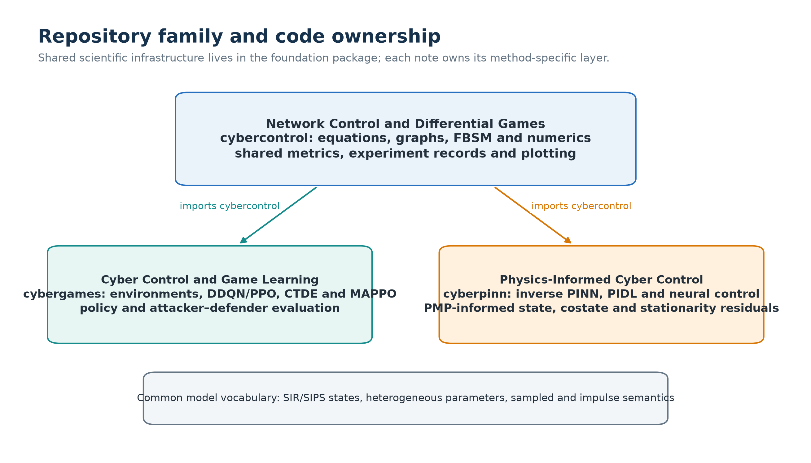
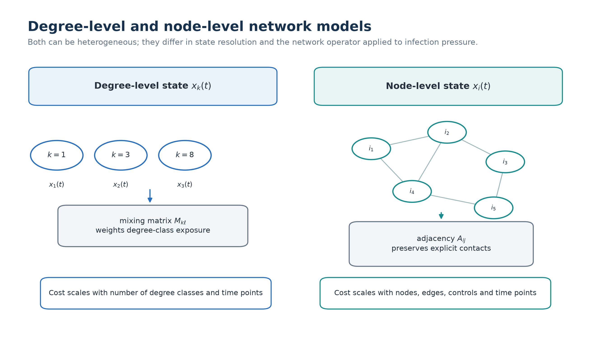
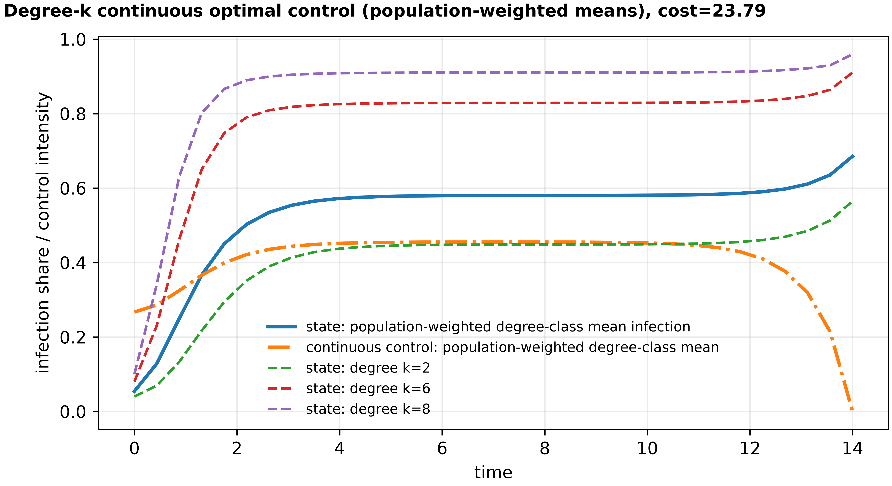

# Network Control and Differential Games

Foundation models and numerical methods for network propagation, heterogeneous
optimal control, differential games and continuous-impulsive intervention. This
repository owns the shared `cybercontrol` package used by the two companion
repositories.

It answers three questions:

- How should aggregate, degree-level and node-level cyber states be defined?
- How do PMP/FBSM and open-loop game updates produce candidate controls?
- Which diagnostics distinguish a completed run from a supported claim?

The examples are reproducible research templates, not calibrated operational
risk models. This repository does not grant one blanket open-source license;
read `LICENSE`, `COPYRIGHT_AND_LICENSE.md` and `THIRD_PARTY_NOTICES.md` before
reuse.

## Repository Family



| Order | Repository | Responsibility |
|---:|---|---|
| 0 | **Network Control and Differential Games** | Shared equations, heterogeneity, graphs, FBSM, neural utilities, metrics and plotting |
| 1 | [Cyber Control and Game Learning](https://github.com/LYang910920/note1-cyber-control-games) | Sampled environments, DDQN/PPO, CTDE, MAPPO and game evaluation |
| 2 | [Physics-Informed Cyber Control](https://github.com/LYang910920/note2-pinn-pidl-cyber-control) | Inverse PINN, PIDL, neural control and PMP-informed learning |

Start with the family [Learning Path](docs/LEARNING_PATH.md). It gives
15-minute, 60-minute and one-day routes through all three repositories.

## First Run

Python 3.10 or newer is required. Install the graph and test extras once:

```bash
python -m pip install -e ".[graph,dev]"
```

Then run the bounded CPU smoke check, normally well under one minute:

```bash
python -m cybercontrol smoke --output-dir artifacts/first_run
```

## Expected Output

| Output | Interpretation |
|---|---|
| `artifacts/first_run/run_manifest.json` | Git state, hardware and smoke metrics needed to identify the run |
| terminal exit code `0` | Packaged equations, solvers and invariants completed without an exception |

The smoke check is a correctness gate, not a convergence or scalability study.

## Read These Two Files

1. [`src/cybercontrol/network_models.py`](src/cybercontrol/network_models.py):
   node-SIPS state order, infection pressure and heterogeneous parameters.
2. [`src/cybercontrol/fbs.py`](src/cybercontrol/fbs.py): degree/node forward,
   adjoint and projected control/game updates.

The notation-to-code table and public API are in
[`docs/MODELS_AND_API.md`](docs/MODELS_AND_API.md).

## Change One Thing

In [`foundation_profiles.py`](src/cybercontrol/foundation_profiles.py), reduce
`DEGREE_CONTROL_PROFILE.control_weight` in its profile definition. A lower
quadratic control penalty should permit stronger intervention; verify the effect
on both infection and total objective rather than assuming it is beneficial.

## Medium Experiment

Run the heterogeneous degree/node control and game suite plus paired
100/1,000/10,000-node scalability cases:

```bash
python -m cybercontrol medium --output-dir artifacts/medium
```

Inspect these files first:

- `artifacts/medium/models/heterogeneous_vs_matched_mean.csv`;
- `artifacts/medium/models/fbs_convergence.csv`;
- `artifacts/medium/scalability/paired_fbs_comparison.csv`;
- `artifacts/medium/run_manifest.json`.

The degree solver is an HMF approximation and the node solver uses explicit
adjacency. They use the same generated graph and mechanism family, but they are
not algebraically identical equations.






## Next Experiment

Repeat the medium run over multiple graph seeds and compare uncertainty in FBSM
runtime and objective. One deterministic seed is sufficient for a tutorial
trace, not for a scalability claim. The artifact and reporting checklist is in
[`docs/REPRODUCIBILITY.md`](docs/REPRODUCIBILITY.md).

## Extension Route

1. Declare state order, adjacency convention, action timing and objective.
2. Resolve scalar/array parameters through `cybercontrol.heterogeneity`.
3. Compare no-action, rule, random and matched homogeneous baselines.
4. Save resolved arrays, seeds, failures and run manifests under `artifacts/`.
5. Move to Note 1 for learned policies or Note 2 for inverse/physics-informed
   estimation; keep shared equations in this repository.

## Validation

The maintained validation sequence is documented in
[`docs/REPRODUCIBILITY.md`](docs/REPRODUCIBILITY.md). Tests cover conservation,
nonnegativity, scalar/vector compatibility, dense/sparse and NumPy/Torch parity,
finite-difference Jacobians, deterministic profiles and reset semantics.

## Citation and License

Use [`CITATION.md`](CITATION.md) for citation guidance. Review [`LICENSE`](LICENSE),
[`COPYRIGHT_AND_LICENSE.md`](COPYRIGHT_AND_LICENSE.md) and
[`THIRD_PARTY_NOTICES.md`](THIRD_PARTY_NOTICES.md) before redistribution.
