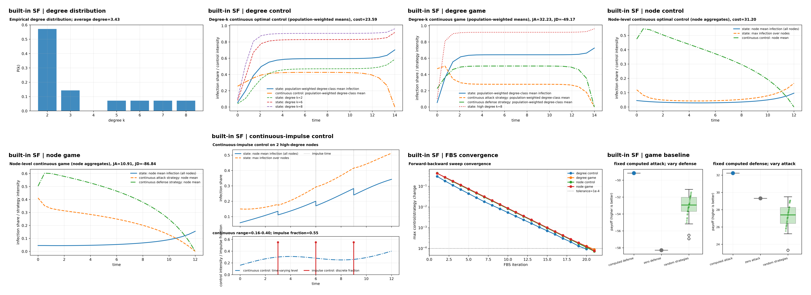
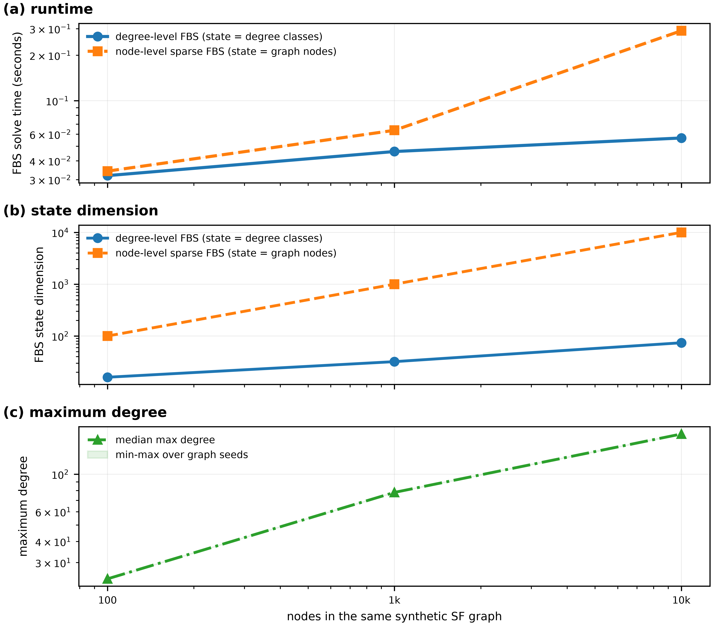

# Network Control and Differential Games

Research and teaching material for network propagation, heterogeneous optimal
control, differential games, impulse intervention and continuous-impulsive
systems. This repository is the foundation of a three-repository family and is
the sole owner of the shared `cybercontrol` Python package.

The notes were developed from the author's research experience in network
control and cyber applications, including publications in IEEE TIFS, TDSC,
TSMC, TNSE and TCSS. The examples are reproducible research templates, not
calibrated operational risk models.

This repository does not grant one blanket open-source license. Read `LICENSE`,
`COPYRIGHT_AND_LICENSE.md` and `THIRD_PARTY_NOTICES.md` before reuse.

## Repository Family


| Order | Repository | Responsibility |
|---:|---|---|
| 0 | **Network Control and Differential Games** | Shared equations, heterogeneous profiles, graph/numerical/FBSM utilities, neural blocks, metrics, manifests and plotting |
| 1 | [Cyber Control and Game Learning](https://github.com/LYang910920/note1-cyber-control-games) | Environments, DDQN/PPO, CTDE, cooperative MAPPO and attacker-defender evaluation |
| 2 | [Physics-Informed Cyber Control](https://github.com/LYang910920/note2-pinn-pidl-cyber-control) | Inverse PINN, PIDL, neural control and PMP-informed learning |

The GitHub slugs remain unchanged so existing links continue to work.

## 5-Minute Quick Start

Python 3.10 or newer is required.

```bash
python -m venv .venv
source .venv/bin/activate
python -m pip install --upgrade pip
python -m pip install -e ".[graph,dev]"
python -m cybercontrol smoke
python -m pytest -q
```

For library-only use without graph or test extras:

```bash
python -m pip install -e .
python -m cybercontrol smoke
```

The smoke command uses packaged kernels only. Medium experiments, figure
generation and PDF builds require the source checkout.

The bundled graph examples and full test suite use the `graph` and `dev`
extras shown in the primary quick start.

The same public runner is used across the family:

```bash
python -m cybercontrol medium --output-dir artifacts/medium
python -m cybercontrol figures
python -m cybercontrol docs
python -m cybercontrol all
```

## Code Map

| Need | Start here |
|---|---|
| Main PDF | [`docs/network_control_foundations.pdf`](docs/network_control_foundations.pdf) |
| Equations, parameters and API | [`docs/MODELS_AND_API.md`](docs/MODELS_AND_API.md) |
| Commands and reproducibility | [`docs/REPRODUCIBILITY.md`](docs/REPRODUCIBILITY.md) |
| Research workflow | [`docs/FROM_MODEL_TO_PAPER.md`](docs/FROM_MODEL_TO_PAPER.md) |
| Shared package | [`src/cybercontrol/`](src/cybercontrol/) |
| Degree/node control and games | [`src/cybercontrol/fbs.py`](src/cybercontrol/fbs.py) |
| Heterogeneous profiles | [`src/cybercontrol/heterogeneity.py`](src/cybercontrol/heterogeneity.py) |
| SIR/SIPS equations | [`src/cybercontrol/models.py`](src/cybercontrol/models.py), [`network_models.py`](src/cybercontrol/network_models.py) |
| Neural, RL and PINN blocks | [`nn.py`](src/cybercontrol/nn.py), [`rl.py`](src/cybercontrol/rl.py), [`pinn.py`](src/cybercontrol/pinn.py) |
| Thin foundation example | [`examples/foundations/code/network_control_examples.py`](examples/foundations/code/network_control_examples.py) |
| Paired scalability | [`examples/foundations/code/scalability_analysis.py`](examples/foundations/code/scalability_analysis.py) |
| Reference repository checks | [`examples/reference/`](examples/reference/) |
| Literature evidence | [`docs/literature/literature_matrix.csv`](docs/literature/literature_matrix.csv) |

## Representative Experiments

The degree and node solvers use the same propagation problem but different state
resolution. Heterogeneous runs are compared with matched-mean homogeneous
profiles and save resolved arrays.


The foundation suite runs heterogeneous degree/node control and games,
continuous-impulsive state jumps, baseline comparisons and FBSM diagnostics.



The scalability experiment uses matched synthetic scale-free graphs and reports
state dimension, degree classes, convergence, runtime and max degree on log
scales. Large profiles are opt-in.



Three preserved reference snapshots connect the framework to paper-level
degree-game, node impulse and awareness-aware propaganda workflows. Their
upstream licenses and notices remain intact.

## Extension Route

1. Define state order, adjacency convention, action timing and objective.
2. Resolve all scalar/array parameters through `cybercontrol.heterogeneity`.
3. Reuse integration, graph and FBSM modules instead of copying a solver.
4. Add a shared helper only when two real callers need it.
5. Compare with no-action, rule, random and matched homogeneous baselines.
6. Save run manifests and generated outputs under ignored `artifacts/`.

The [models/API guide](docs/MODELS_AND_API.md) contains the old-to-new import
map and the [paper guide](docs/FROM_MODEL_TO_PAPER.md) gives an experiment and
manuscript checklist.

## Validation

```bash
python -m compileall -q src examples tests scripts
python -m ruff check src tests examples scripts
python -m pytest -q
python -m cybercontrol smoke --output-dir artifacts/validation/smoke
python -m cybercontrol figures
python -m cybercontrol docs
```

Tests cover conservation/nonnegativity, scalar-vector compatibility,
dense-sparse and NumPy-Torch parity, finite-difference Jacobians, deterministic
profiles and reset semantics. See `docs/REPRODUCIBILITY.md` for medium and
million-node commands.

## Citation and License

Use [`CITATION.md`](CITATION.md) for citation guidance. Review [`LICENSE`](LICENSE),
[`COPYRIGHT_AND_LICENSE.md`](COPYRIGHT_AND_LICENSE.md) and
[`THIRD_PARTY_NOTICES.md`](THIRD_PARTY_NOTICES.md) before redistribution.
