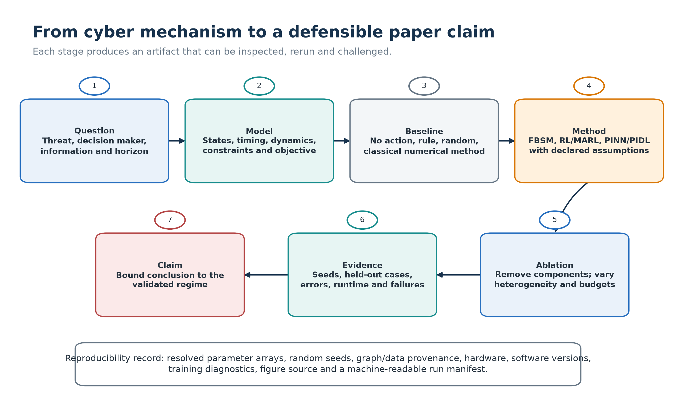

# From Model to Paper

This workflow turns a network-control model into a reproducible study. The
foundation repository supplies the equations, numerical methods and baseline
diagnostics; Note 1 and Note 2 provide the game-learning and physics-informed
paths.

## 1. State the problem

Record the following before selecting an algorithm:

| Decision | Required specification |
| --- | --- |
| State | Aggregate, degree-indexed or node-indexed state; order, shape and units. |
| Coupling | Degree mixing matrix or adjacency convention and normalization. |
| Heterogeneity | Resolved physical and economic arrays, profile seed and matched-mean baseline. |
| Timing | Continuous-time signal, sampled-data/ZOH action, switched mode, reset or continuous-impulsive combination. |
| Objective | Running, terminal and jump terms with one declared sign convention. |
| Information | What each controller or player observes when choosing an action. |

Use [`MODELS_AND_API.md`](MODELS_AND_API.md) to map notation to package objects.

## 2. Establish numerical baselines

Run the uncontrolled model first, then fixed, rule-based and random controls on
the same state equation and horizon. For optimal control, report the PMP/FBSM
candidate together with convergence residuals and independent objective
evaluation. For a game, hold one player's candidate fixed while varying the
other player's strategy; a training curve is not evidence of Nash equilibrium.

For impulse or continuous-impulsive models, compare no-reset, fixed-reset,
continuous-only and impulse-only cases. Keep running and jump costs separate.

## 3. Select the method

### PMP and FBSM

Derive the Hamiltonian, state equation, adjoint equation, endpoint condition and
projected stationarity update. State the discretization, relaxation factor,
tolerance and maximum iterations. Verify finite-difference derivatives where
an analytic Jacobian is used.

### RL and MARL

Define observation, action, transition order, reward, termination and action
budget before training. Distinguish solver substeps from policy decision epochs.
Evaluate held-out parameter profiles, graph seeds, topology families, sizes and
budgets. Note 1 contains the detailed workflow.

### PINN and PIDL

List observed components and times, unknown quantities, collocation points and
every residual term. Separate data, ODE, initial/boundary, conservation and
regularization losses. Validate with an independent ODE rollout and compare a
heterogeneous estimator with a matched homogeneous misspecification baseline.
Note 2 contains the detailed workflow.

## 4. Design the experiment matrix

Use multiple random seeds and predeclare the comparison axes:

1. homogeneous versus heterogeneous physical and economic parameters;
2. degree-level versus node-level resolution on matched graphs;
3. no control, fixed/rule, budget-matched random and optimized or learned policy;
4. observed versus held-out parameter seeds, graph seeds and time windows;
5. at least one ablation that removes a claimed mechanism;
6. parameter, horizon, budget and observation-noise sensitivity.

Save the complete resolved arrays, configuration, software versions, hardware,
runtime and failure status. [`REPRODUCIBILITY.md`](REPRODUCIBILITY.md) gives the
commands and artifact conventions.

## 5. Report evidence

The minimum figure set is:

1. state evolution versus time, identified as a node, degree class or aggregate;
2. continuous controls as curves and impulses as event markers;
3. FBSM or training diagnostics against iteration;
4. same-model baseline comparison with uncertainty across seeds;
5. two game-response panels: fixed attack with varied defense, and vice versa;
6. one ablation or sensitivity figure tied to the paper's central claim.

Captions should define axes, aggregation, control timing, baseline matching,
seeds and uncertainty. Report negative and non-converged cases rather than
silently excluding them.

## 6. Manuscript order

1. Threat scenario and research question.
2. Related work and precise gap.
3. State, dynamics, controls, information and objective.
4. Optimality, game or learning method with assumptions.
5. Algorithm and reproducibility details.
6. Experimental design, baselines and metrics.
7. Results, ablations, sensitivity and held-out tests.
8. Identifiability, equilibrium, scalability and external-validity limits.
9. Conclusions restricted to the validated regime.
