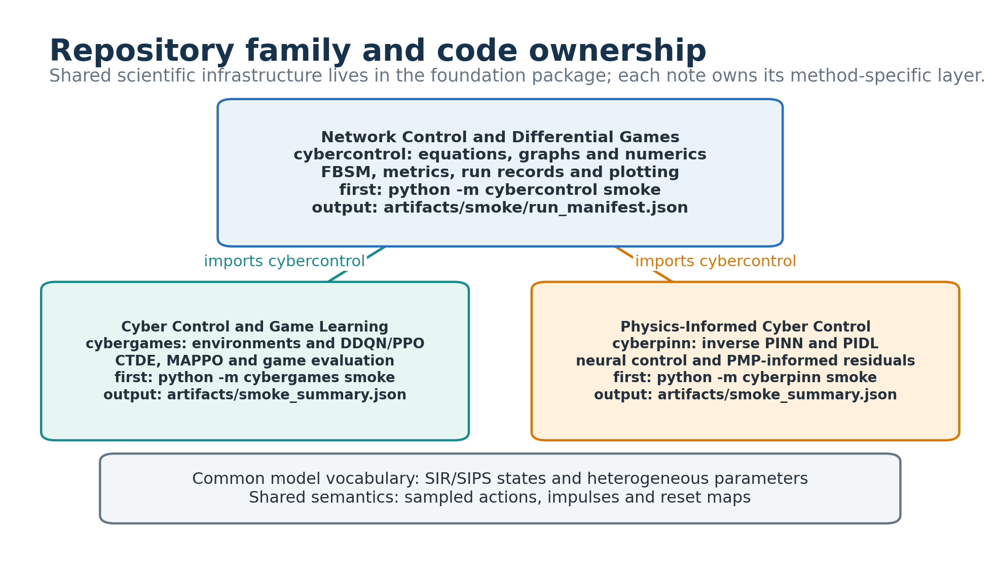
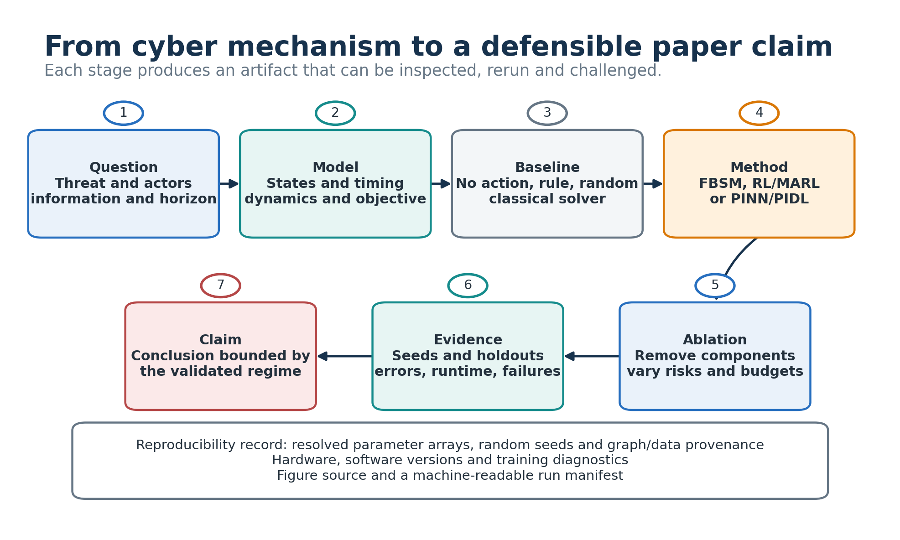

# Learning Path: From Dynamics to Evidence

This is the single learning route for the three-repository family. Begin with
the state equation and numerical evidence in the Foundation, then choose the
game-learning or physics-informed branch. The notes remain independently
readable, but this order prevents methods from being detached from their model.

## Prerequisites

- Python 3.10 or newer;
- NumPy arrays, ordinary differential equations and basic graph notation;
- gradients and constrained optimization for PMP/FBSM;
- probability and neural-network basics before Note 1 or Note 2.

No GPU is required for the smoke checks. Medium neural experiments select
CUDA, Apple MPS or CPU through the public runner and record the resolved device.

## 15-Minute Route

### 1. Foundation: verify the model contract

Run `python -m cybercontrol smoke --output-dir artifacts/first_run` and open
`artifacts/first_run/run_manifest.json`.

Read:

- `cybercontrol.network_models.node_sips_rhs_numpy` for state order and flows;
- `cybercontrol.fbs.solve_degree_control` for the state-adjoint-control loop.

Check that a state label identifies an aggregate, degree class or node, and that
continuous controls are curves while impulses are reset events.

### 2. Note 1: verify the learning transition

Run `python -m cybergames smoke` and open `artifacts/smoke_summary.json`.

Trace one call to `NodeSIPSEnv.step`: observation, budgeted sampled-flow action,
ZOH ODE integration, interval reward and next observation. This cooperative
environment has no reset; the separate aggregate environment demonstrates
optional impulse/reset semantics. Then locate GAE and the clipped-PPO update in
`cybergames.mappo`.

### 3. Note 2: verify the residual contract

Run `python -m cyberpinn smoke` and open `artifacts/smoke_summary.json`.

Trace the separation between observed data points and collocation points. Check
that learned states use the declared SIR/SIPS order and that validation includes
an independent simulator or held-out state comparison.

## 60-Minute Route

### Foundation

1. Read [`MODELS_AND_API.md`](MODELS_AND_API.md), especially degree mixing,
   node adjacency orientation and the continuous-impulsive reset map.
2. Run the medium command from the README.
3. Inspect `heterogeneous_vs_matched_mean.csv` and `fbs_convergence.csv`.
4. Explain why degree-HMF and explicit-node results are related but not identical.

### Note 1

1. Read `docs/METHODS_AND_API.md` in the Note 1 repository.
2. Compare uniform, degree, risk, oracle and budget-random policies.
3. Distinguish the cooperative budget coordinator from the separate
   attacker-defender actor-critic.
4. Treat fixed-policy cross-play as evidence, not a Nash certificate.

### Note 2

1. Read `docs/METHODS_AND_API.md` in the Note 2 repository.
2. Compare homogeneous misspecification with community/factorized estimators.
3. Separate state error, parameter/effective-rate error and residual error.
4. Explain why residual consistency does not remove non-identifiability.

## One-Day Route

### Morning: model and baseline

1. Write state, coupling, heterogeneity, timing, objective and information in a
   one-page model contract.
2. Run uncontrolled, fixed/rule and budget-matched random baselines.
3. Verify conservation, nonnegativity, graph orientation and time-step
   sensitivity before optimizing or training.

### Afternoon: method and held-out evaluation

Choose one path:

- **PMP/FBSM:** derive the Hamiltonian, adjoint, endpoint condition and
  projected stationarity update; record relaxation, tolerance and residuals.
- **RL/MARL:** define observation/action/reward/termination, train with separate
  seeds and test unseen profiles, graphs, sizes and budgets.
- **PINN/PIDL:** define observations, unknowns and gauges, then reserve held-out
  times/nodes/graphs before fitting.

Finish with one ablation tied to the claim and one failure/sensitivity result.

## Model-to-Code Map

| Mathematical object | Foundation | Note 1 | Note 2 |
|---|---|---|---|
| SIR/SIPS right-hand side | `cybercontrol.models`, `network_models` | imported into environments | imported into residual/data problems |
| Graph/degree coupling | `graph_data`, `graph_utils`, `heterogeneity` | environment observations and budgets | node features and residuals |
| Continuous control/game | `fbs` | short baseline bridge | PMP-informed comparison |
| Sampled transition | timing/reset utilities | `envs`, `node_env`, `adversarial_env` | optional data-generation boundary |
| Neural blocks and runtime | `nn`, `rl`, `experiments` | DDQN/CTDE/MAPPO | inverse/PIDL/control/PMP |
| Evidence record | manifests, metrics, plotting | evaluation and response tables | held-out and identifiability metrics |

## From Model to Paper

### 1. State the problem

Declare state shape and units, coupling convention, resolved heterogeneous
arrays, action timing, running/terminal/jump objectives and each player's
information. Map symbols to code through [`MODELS_AND_API.md`](MODELS_AND_API.md).

### 2. Establish baselines

Run no-action, fixed/rule and random policies on the same state equation and
horizon. For games, fix one candidate while varying the other player. For
continuous-impulsive models, separate continuous-only, impulse-only and combined
cases, including their running and jump costs.

### 3. Design the experiment matrix

Predeclare seeds, graph families, sizes, parameter shifts, budgets, observation
noise and at least one mechanism ablation. Save resolved arrays, software,
hardware, runtime and failures as described in
[`REPRODUCIBILITY.md`](REPRODUCIBILITY.md).

### 4. Report evidence

At minimum report state evolution, control/reset timing, convergence or training
diagnostics, same-model baselines with uncertainty, game response/deviation
evidence where applicable, and an ablation or sensitivity result. Captions must
define aggregation, axes, seed count, uncertainty and whether lower or higher is
better.

### 5. Bound the claim

Necessary-condition candidates are not proven optima or equilibria. Training
reward is not an equilibrium test. A small PINN residual is not parameter truth.
Conclusions must remain within the tested models, graphs, observations and
budgets.

## Recommended Repository Order

1. **Foundation** for model semantics, PMP/FBSM, games and continuous-impulsive
   control.
2. **Note 1** when actions are selected at decision epochs and learned from
   interaction.
3. **Note 2** when states, parameters, mechanisms or controls are learned under
   differential-equation constraints.

Return to the Foundation whenever a companion method needs a new shared
equation, integrator, graph helper or plotting primitive.
