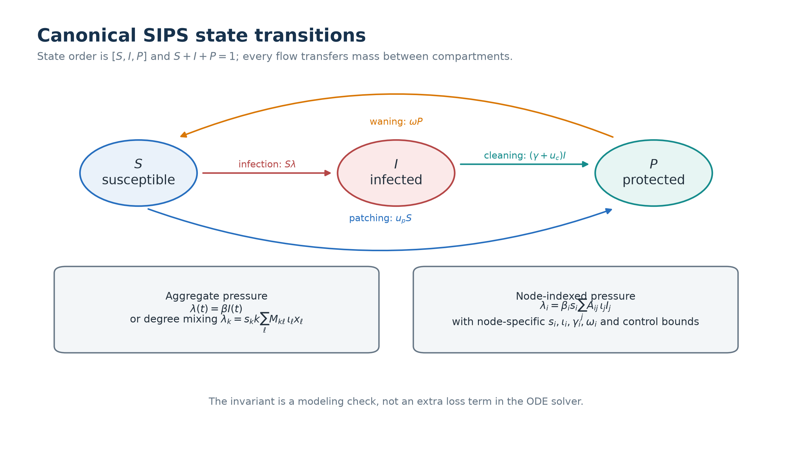
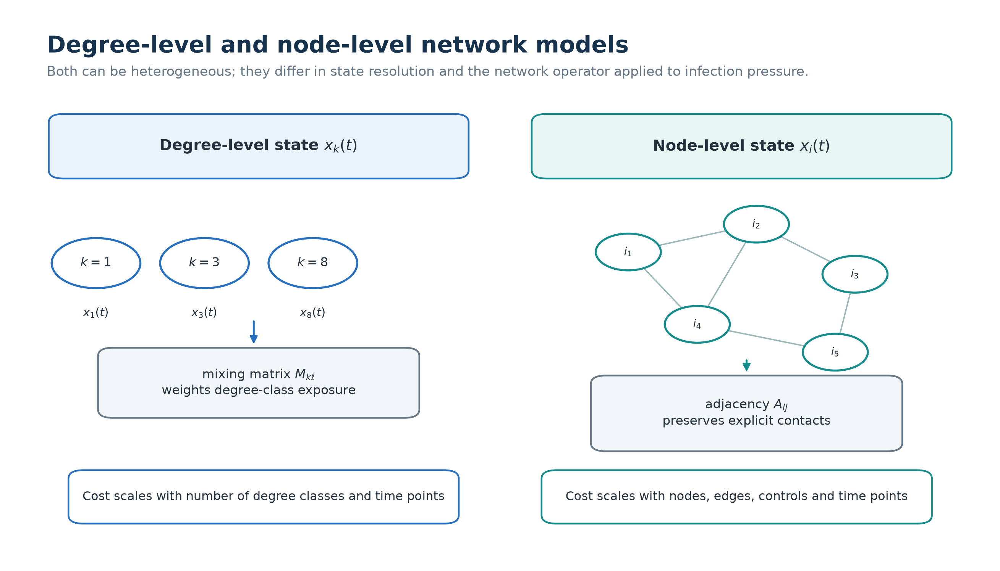
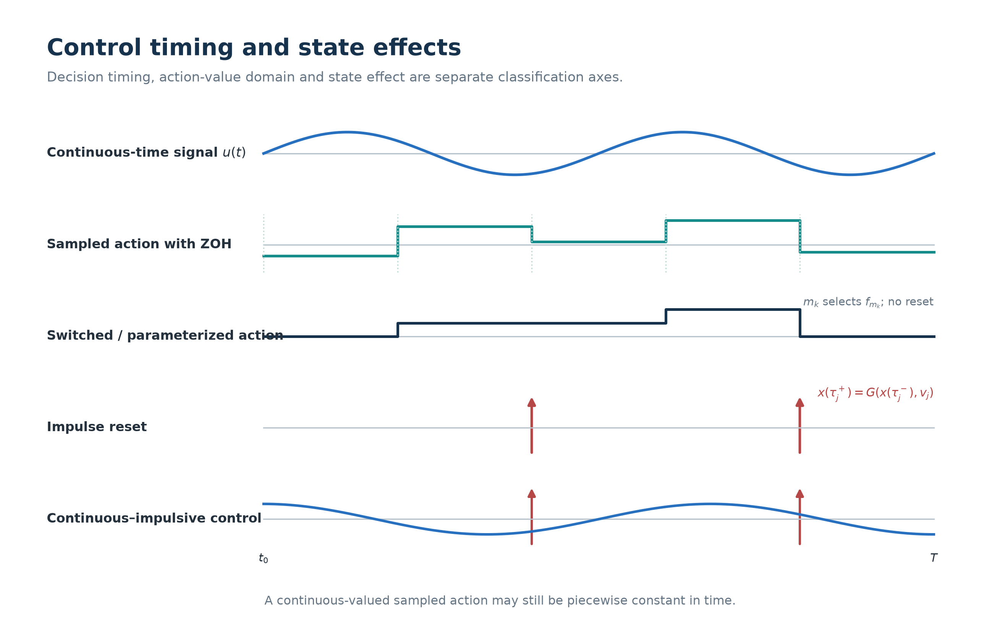

# Models and Public API

This guide connects the equations in `network_control_foundations.pdf` to the
installable `cybercontrol` package. The foundation repository owns shared
equations, integration, graph operations, FBSM helpers, experiment records,
neural blocks and plotting. The two companion repositories import these APIs.

## State and network resolution

| Resolution | State | Infection pressure | Use |
|---|---|---|---|
| Aggregate SIR/SIPS | one population vector | `beta * S * I` | inspect equations and debug a method |
| Degree level | one state per degree class `k` | `lambda_k = s_k k sum_l M_kl i_l x_l` | retain degree heterogeneity with a small state |
| Node level | one state per node `i` | `lambda_i = beta_i s_i sum_j A_ij iota_j I_j` | targeted controls and explicit contacts |

For SIPS, the state order is `[S, I, P]`. Patching transfers `S -> P`,
cleaning/recovery transfers `I -> P`, and waning transfers `P -> S`. The flow
preserves `S + I + P = 1` for every node. SIS examples store the infected share
only; the susceptible share is `1 - I`.

The adjacency convention is `A[i, j] = weight from node j to node i`. CSV and
graph loaders convert once to this convention. Dense NumPy, sparse NumPy and
Torch equations are tested against the same state and parameters.

## Heterogeneous parameters

`cybercontrol.heterogeneity` resolves scalars or arrays into validated model
profiles. Scalar inputs broadcast and reproduce the homogeneous equations.

| Profile | What varies | Reproducibility record |
|---|---|---|
| `homogeneous` | no parameter variation | scalar base values and resolved arrays |
| `degree-correlated` | rates, weights, costs or bounds by degree | degree sequence and strength |
| `community-correlated` | node parameters by community | community labels and seed |
| `seeded-lognormal` | positive multiplicative variation | seed, strength and matched mean |
| array/CSV | caller-supplied values | validated full arrays and source path |

Every paper run should save the resolved arrays, summary statistics, seed,
heterogeneity strength and a matched-mean homogeneous profile. Comparing only
different initial states is not a heterogeneity study.

## Control and game semantics

- A continuous-time control `u(t)` is defined throughout the horizon and may
  vary inside an interval.
- A sampled action `a_k` is selected at `t_k`. Under zero-order hold,
  `u(t) = Gamma(a_k)` on `[t_k, t_{k+1})`.
- A switched mode selects a vector field and does not by itself reset state.
- An impulse has an explicit jump `x(tau_j+) = G(x(tau_j-), v_j)`.
- Continuous-impulsive control combines a flow control with explicit jumps.

Running costs and jump costs are separate terms. The game solvers use
player-specific objectives; a computed open-loop profile is checked with
unilateral deviations rather than described as an equilibrium from convergence
alone.

## Public modules

| Module | Stable responsibility |
|---|---|
| `cybercontrol.models` | aggregate SIR/SIPS right-hand sides |
| `cybercontrol.network_models` | degree/node SIPS equations and Torch parity |
| `cybercontrol.heterogeneity` | parameter resolution and deterministic profiles |
| `cybercontrol.numerics` | RK4/grid integration, projections and quadrature |
| `cybercontrol.graph_utils` | normalized dense/sparse graph operations |
| `cybercontrol.graph_data` | graph loading and degree aggregation |
| `cybercontrol.fbs` | heterogeneous degree/node control and game sweeps |
| `cybercontrol.rl` | replay, rollout and generalized advantage estimation |
| `cybercontrol.nn` | typed MLP, residual, Fourier and node-time blocks plus the shared architecture registry |
| `cybercontrol.pinn` | residual and derivative helpers shared by Note 2 |
| `cybercontrol.experiments` | device choice, hardware summary and run manifests |
| `cybercontrol.plotting` | separate publication and guide styles |

## Foundation parameters

The named profiles in `cybercontrol.foundation_profiles` are the visible source
of example defaults.

| Experiment | Horizon | Base rates | Control/game settings |
|---|---:|---|---|
| degree control | 14 | `beta=0.65`, `delta=0.18` | state weight 3.0, control weight 2.5, `u_max=1.2` |
| node control | 12 | `beta=0.90`, `delta=0.16` | state weight 3.0, control weight 2.2, `u_max=1.2` |
| degree game | 14 | `beta=0.60`, `delta=0.15` | attack/defense bounds 1.2; costs 3.0/4.0 |
| node game | 12 | `beta=0.95`, `delta=0.15` | attack/defense bounds 1.2; costs 4.0/4.5 |
| continuous-impulsive | 12 | `beta=0.95`, `delta=0.15` | flow in `[0.10,0.52]`; 55% jumps at 3, 6 and 9 |

The degree- and node-correlated profiles resolve physical coefficients,
state/payoff weights, action costs, and action bounds as class- or node-indexed
arrays. Node profiles use nonzero-neighbour degree, so the same topology yields
the same heterogeneity after row, spectral, or max-degree normalization.

FBSM diagnostics record iteration count, residual, convergence flag, objective
and relaxation. A parameter change is accepted only after the state invariant,
finite-difference Jacobian and convergence trace remain valid.

## Import migration

Reusable logic formerly embedded in `examples/foundations/code/` now lives in
the package:

| Previous path | Current import |
|---|---|
| `network_control_examples.solve_degree_control` | `cybercontrol.fbs.solve_degree_control` |
| `network_control_examples.solve_node_game` | `cybercontrol.fbs.solve_node_game` |
| `model_profiles.*` | `cybercontrol.foundation_profiles.*` |
| local graph-loading helpers | `cybercontrol.graph_data` |
| local scalability solver | `cybercontrol.scalability` |
| local Torch helper copies | `cybercontrol.nn`, `cybercontrol.rl`, `cybercontrol.pinn` |

The example files remain orchestration and reporting entry points. New methods
should import package functions rather than add another solver implementation.

## Neural architecture records

`ArchitectureRegistry` is the shared construction and reporting interface used
by both companion repositories. Each registered model records its input/output
shape, activation, normalization, encoder, temporal block, pooling, decoder,
initialization and per-component parameter count. `model_summary()` and
`shape_trace()` provide the corresponding checks for standalone modules. This
metadata is diagnostic: it does not imply that two architectures with similar
parameter counts have equal optimization difficulty or inductive bias.
